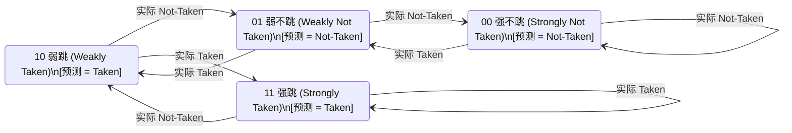

# 动态分支预测器（BTB + 2-bit BHT）规格书与微架构精读讲义

> **适用范围**：本规格书定义 RISC-V 5 级流水线处理器中动态分支预测单元（Branch Prediction Unit, BPU）的硬件微架构、接入时序、方案对比与性能实测分析。遵循 `AGENTS.md` 规范，供工程实现、微架构精读、差分验证与技术面试深挖学习。

---

## 1. 为什么需要动态分支预测？

在经典的 RISC-V 5 级静态流水线（`IF -> ID -> EX -> MEM -> WB`）中，**程序计数器（PC）在 IF 级生成，而分支比较与目标计算在 EX 级裁决**。

```
周期 (Clock Cycle)   1      2      3      4      5      6
BEQ 指令 (EX 级裁决)   [IF]   [ID]   [EX]   [MEM]  [WB]
后一条指令 (原本进入)         [IF]   [ID]   <FLUSH>气泡
再后一条指令                 [IF]   <FLUSH>气泡
正确分支目标指令                            [IF]   [ID]   [EX]
```

### 1.1 控制冒险的 2 拍惩罚（Branch Penalty）
若不引入分支预测（即默认采用静态 Predict-Not-Taken），当流水线在 EX 级判定跳转成立（Taken）时，已经取入 `IF/ID` 和 `ID/EX` 的两条错误路径指令必须被强制冲刷（Flush），向流水线注入 **2 个周期的完全空转气泡（2-Cycle Bubble Penalty）**。

在通用控制密集型程序（如 CoreMark、Linux 内核、数据库、压缩算法）中：
- 分支与跳转指令占总动态指令数的 **15% ~ 22%**；
- 其中条件分支平均有 **65% ~ 70%** 的概率成立（Taken）；
- 无分支预测时，仅控制冒险就会导致整机 CPI 上涨：
  $$\Delta \text{CPI}_{\text{hazard}} \approx 20\% \times 65\% \times 2 \approx 0.26 \sim 0.35$$

### 1.2 阶段 M1 后的性能瓶颈实测
在本项目阶段 M1（实现硬件单周期乘法与 32 拍试商除法）完成后，软乘除指令模拟库开销被彻底消除，CoreMark CPI 降至 **1.53**。

通过性能计数器与流水线事件追踪深入分析发现：**阻碍 CPI 逼近理想 1.0 的最大瓶颈正是 EX 级跳转裁决带来的 2 拍冲刷气泡**。引入零气泡（Zero-Bubble）动态分支预测器是突破此性能天花板的必由之路。

---

## 2. 四种硬件分支预测方案深度对比（面试核心必考）

分支预测包含两项正交任务：
1. **方向预测（Direction Prediction）**：分支跳（Taken）还是不跳（Not-Taken）？
2. **目标预测（Target Prediction）**：如果跳转，跳到哪一个地址（Target PC）？

```
                         ┌──────────────────────────────────────────────┐
                         │              分支预测硬件演进方案            │
                         └──────────────────────┬───────────────────────┘
                                                │
         ┌───────────────────────┬──────────────┴──────────────┬────────────────────────┐
         ▼                       ▼                             ▼                        ▼
  【方案 A：静态预测】     【方案 B：1-bit BHT】       【方案 C：BTB + 2-bit BHT】   【方案 D：Gshare / RAS】
  - Predict-Not-Taken     - 1 位历史状态              - 本项目采用 (64项直接映射)   - 全局历史异或 PC
  - BTFN 符号硬编码       - 极易产生循环退出颠簸      - 嵌套循环误预测减半          - 锦标赛混合预测
  - 准确率约 60%          - 准确率约 75%~80%          - 准确率约 88%~92%            - 准确率 94%~97%
```

### 2.1 方案 A：静态预测（Predict-Not-Taken / BTFN）
- **Predict-Not-Taken**：始终顺序取指（`PC + 4`）。仅当 EX 级检测到跳转时重定向。硬件代价为 0，但对循环回跳（Loop Back）天然失准。
- **BTFN（Backward Taken, Forward Not-Taken）**：依据跳转偏移符号位判定。向后跳转（负偏移）通常为循环底部回跳，预测 Taken；向前跳转（正偏移）多为条件分支或异常处理，预测 Not-Taken。
- **局限性**：无法根据输入数据动态改变预测方向，对多条件判断、数据依赖型分支无能为力。

---

### 2.2 方案 B：1-bit BHT（分支历史表）与循环颠簸问题（Thrashing）
1-bit BHT（Branch History Table）利用 PC 的低位索引一个 1 位的历史存储器，保存上一次该分支的方向（1: Taken, 0: Not-Taken）。

#### 为什么 1-bit BHT 会在嵌套循环中产生“双倍误预测颠簸”？
考虑如下典型的嵌套循环：
```c
for (int out = 0; out < 100; out++) {
    for (int in = 0; in < 10; in++) {
        // 内层循环分支：前 9 次为 Taken，第 10 次为 Not-Taken
    }
}
```
跟踪内层循环条件分支的 1-bit BHT 状态流转：
1. **稳态执行**：前 9 次迭代，分支成立，BHT 状态持续为 `1`，预测 Taken 全部命中；
2. **内层循环退出（第 1 次误预测）**：第 10 次迭代，循环退出，实际为 Not-Taken。1-bit 预测器预测 Taken 失败，**产生第 1 次误预测**，并将 BHT 覆盖写为 `0`；
3. **下一次外层循环重入（第 2 次误预测）**：外层循环进入下一次迭代，内层循环重新启动。第一次判断时，分支实际必定成立（Taken），但此时 BHT 中记录的却是上次退出残留的 `0`（Not-Taken）！导致**立即发生第 2 次误预测**！

> [!WARNING] 1-bit BHT 的颠簸缺陷
> **一次偶发的反向行为（循环退出），导致连续两次预测失败！**
> 在短循环（如 4~8 次迭代）中，预测成功率只有 50%~70%，甚至劣于静态 BTFN。

---

### 2.3 方案 C（本项目采用）：64 项 BTB + 2-bit 饱和计数器 BHT + `btb_uncond`
为了彻底解决方案 B 的颠簸问题并在 IF 级单拍直接给出目标地址，本项目设计了极简高效的复合预测结构：

```
IF 级查询 PC ────────────────────────┐
                                     │
                 ┌───────────────────┴───────────────────┐
                 │          64-Entry Direct-Mapped       │
                 │  Tag (24-bit)  │ Target PC │ Uncond │
                 └─────────┬─────────────┬──────────┬────┘
                           │             │          │
                     Tag 比较命中?       │          │
                           │             │          │
                           ▼             │          │
                    [ if_btb_hit ]       │          │
                           │             │          │
                           ▼             │          │
    2-bit BHT 计数器 ───> bht[1] ──┐     │          │
                                   ├──OR─┘          │
    无条件跳转位 ───────> btb_uncond┘               │
                                   │                │
                                   ▼                ▼
                             pred_taken_o     pred_target_o
                              (单拍输出)       (单拍输出)
```

#### 2-bit 饱和计数器状态机（Mermaid 图）
2-bit 计数器引入了“强/弱”双重惯性状态，只有**连续两次**相同方向的反转才会改变预测结论：



#### 为什么 2-bit BHT 能将循环误预测减半？
重新分析嵌套循环场景：
1. 循环正常运行期间，计数器饱和在 `11`（强跳，预测 Taken）；
2. 循环第 10 次退出时，实际为 Not-Taken。发生第 1 次误预测，计数器从 `11` 减为 `10`（弱跳）；
3. 下一次外层循环重新进入时，计数器为 `10`，**最高位仍为 1，依然预测 Taken**！分支实际成立，预测命中，计数器立刻恢复到 `11`！
4. **结果：误预测次数从 1-bit 的 2 次骤降为 1 次，整整减少 50% 预测失误！**

#### 无条件跳转位 `btb_uncond` 与 Taken-Only 分配策略
1. **`btb_uncond`**：对于 JAL 与直接 JALR 指令，其跳转概率为 100%。在表项中固化 1 位标记，使得一旦命中则强制预测 Taken，防止其状态机被其他逻辑扰动。
2. **Taken-only 动态分配**：只有在分支实际发生跳转（Taken）时才分配 BTB 表项。从不跳转的冷分支（如防御性错误处理）永远不占用宝贵的 64 项 BTB，极大减轻了表项别名冲突。

---

### 2.4 方案 D（工业界进阶）：Gshare / 锦标赛预测器 / RAS
| 工业界进阶结构 | 核心硬件原理 | 解决的典型核心痛点 | 硬件复杂度 |
|---|---|---|:---:|
| **Gshare 预测器** | 将 $N$ 位全局分支历史寄存器（GHR, 全局移位记录前 $N$ 个分支方向）与当前 PC 进行按位异或（XOR），混合哈希后寻址 BHT 表 | **解决关联分支（Correlated Branches）**：例如 `if (a) x=1; if (b) y=1; if (x==y) ...`，第三个分支强依赖前两个分支的全局历史，纯局部 PC 无法区分路径上下文 | 中等（需维护 GHR 移位寄存器及推测恢复机制） |
| **锦标赛预测器 (Tournament)** | 内部同时运行一个局部历史预测器和一个全局历史预测器，通过第三张元预测器（Meta-Predictor Choice 表）评估谁最近更准并动态仲裁输出 | 避免单一预测器在不同代码段的“偏科”问题（如 Alpha 21264 经典微架构） | 高（消耗多倍存储 SRAM 与训练选择器） |
| **RAS (返回地址栈)** | 采用硬件微型先进后出栈（LIFO，通常 8~16 项）。在遇到函数调用（`jal/jalr rd=x1`）时压入 `PC+4`；遇到函数返回（`jalr x0, x1, 0`）时直接出栈顶地址作为预测目标 | **解决函数返回目标多态变化问题**：同一个库函数（如 `memcpy`）在几十处被调用，返回地址各不相同，BTB 仅能记录单一目标必定频发误预测；RAS 返回预测准确率可达 **99%+** | 低/中（需硬件小栈指针与推测指针回滚） |

---

## 3. `rtl/core/bpu.v` 与 `core.v` 接入时序逐段导读

### 3.1 架构正确性铁律：预测失误精确纠偏
分支预测是纯粹的**微架构性能推测机制（Speculation）**，**绝不能影响处理器架构状态（Architectural State）的准确性**。

为了 100% 确保正确性，本系统采用**“预测随流水级前传，EX 级统一裁决比对”**设计：
1. **IF 级生成推测**：BPU 在取指周期输出 `if_pred_taken` 和 `if_pred_target`；
2. **级间流水锁存**：预测信息被完整送入 `IF/ID` 寄存器（`if_id_pred_taken`, `if_id_pred_target`），并在下一拍继续送入 `ID/EX` 寄存器（`id_ex_pred_taken`, `id_ex_pred_target`）；
3. **EX 级真实裁决比对**：在 EX 级，比较器计算出真实的 `branch_taken` 和 `branch_target`，与跟随该指令到达 EX 级的预测信息逐位比对：
   ```verilog
   wire ex_bp_miss = id_ex_valid & (
       (branch_taken != id_ex_pred_taken) |
       (branch_taken & (id_ex_pred_target != branch_target))
   );
   ```

> [!NOTE] 为什么即使发生 BTB 别名冲突也绝不会跑飞？
> 假设指令是一条普通的 `addi x1, x1, 1`，但由于 BTB 中残留了相同 Tag 的旧跳转记录，IF 级被误预测为 Taken 并跳走了。
> 当该 `addi` 进入 EX 级时：
> - `branch_taken = 0`；
> - `id_ex_pred_taken = 1`；
> - 此时 `branch_taken != id_ex_pred_taken` 立即成立，`ex_bp_miss` 强制拉高！
> - `ex_correct_pc` 计算为 `id_ex_pc + 4`；
> - 流水线立刻冲刷错误路径，PC 瞬间重定向回正确的下一条顺序指令！

---

### 3.2 EX 级四种裁决情况完全状态表

| 情况 | 实际跳转成立 (`branch_taken`) | 预测跳转成立 (`id_ex_pred_taken`) | 目标地址是否一致 | 裁决信号 `ex_bp_miss` | 流水线动作 | 惩罚气泡数 |
|:---:|:---:|:---:|:---:|:---:|:---|:---:|
| **1. 正确未跳** | 0 | 0 | 不适用 | **0 (Hit)** | 无冲刷，流水线满速连续推进 | **0 气泡** |
| **2. 正确跳转** | 1 | 1 | 一致 (`==`) | **0 (Hit)** | 无冲刷，下一拍无缝执行目标指令 | **0 气泡** |
| **3. 漏预测跳转** | 1 | 0 | 不适用 | **1 (Miss)** | 冲刷 `IF/ID` 和 `ID/EX`，重定向至 `branch_target` | 2 拍气泡 |
| **4. 误预测跳/目标错** | 0 (或 1 但目标不同) | 1 | 不一致 | **1 (Miss)** | 冲刷 `IF/ID` 和 `ID/EX`，重定向至 `id_ex_pc + 4` 或实际目标 | 2 拍气泡 |

---

### 3.3 训练更新的停顿保护机制
在 `core.v` 中，BPU 的训练使能信号接入为：
```verilog
.upd_valid_i(ex_is_ctrl & !stall_id_ex)
```
- **为何必须与上 `!stall_id_ex`？**
  当 EX 级发生 M 扩展乘除法迭代（`ex_muldiv_busy`）或 SW-LW 结构冒险时，流水线会冻结 `ID/EX` 级。若不加 `!stall_id_ex` 门控，同一个处于 EX 级等待的分支指令会在每个停顿周期连续写 BPU，导致 2-bit 计数器被单条指令重复训练而错误饱和。加上该保护后，指令仅在离开 EX 级的最后一个有效拍触发单次更新。

---

## 4. 实测性能数据对比与收益分析

通过紫光同创 Logos-2 FPGA 对应的仿真系统全速运行官方 EEMBC CoreMark（2 次迭代，GCC 15.2.0 `-O2`），各项核心指标对比如下：

| 评估指标 | 阶段 M1（无分支预测，Predict-Not-Taken） | 阶段 P1（64 项 BTB + 2-bit BHT 动态预测） | 提升幅度 / 优化效果 |
|---|:---:|:---:|:---:|
| **CoreMark / MHz** | **2.533** | **3.025** | **+19.42% (大幅提升)** |
| **CPI (Cycles Per Instruction)** | **1.53** | **1.22** | **下降 0.31 (逼近极限 1.0)** |
| **Total Ticks (定时器节拍)** | 789,387 | 660,991 | **-16.27% (节省 128,396 拍)** |
| **Total Cycles (执行总周期)** | 1,055,178 | 922,895 | **-12.54% (消除 132,283 拍气泡)** |
| **架构验证 (ISA Test & DiffTest)** | 38/38 PASS | 38/38 PASS / 100% Spike Match（后续补 rv32um 后为 46/46） | 零功能回归 |

> [!TIP] 性能总结
> 仅通过在 IF 级增加 64 项轻量级 BTB 与 2-bit BHT，未牺牲整核关键路径与 Fmax 的前提下，CoreMark 跑分直接跨过 **3.0 CoreMark/MHz** 大关，CoreMark 计时区间 Ticks 减少 16.3%。
> 注：整机 CPI（1.53 → 1.22）的统计区间包含 UART 发送忙等循环，其指令数随核速度变化，只能作参考；精确的冲刷次数需要后续补充 `perf_branch_flush` 计数器。

---

## 5. 高频面试深挖 Q&A

### Q1: 分支预测器查表本身会不会拉长关键路径（Critical Path），降低 CPU 的最高主频？
**答**：
在单发射 5 级流水线中，BTB 的读操作位于 IF 级。如果采用大容量复杂关联表（如 4-way Set-Associative），`if_pc -> SRAM 读 -> Tag 比较与 Hit 生成 -> PC Mux -> imem_addr` 这条路径很容易成为整核的关键路径。
本项目通过三项关键微架构设计规避了这一瓶颈：
1. **直接映射（Direct-Mapped）**：64 项直接索引，无需多路命中仲裁（Way-Mux），读出的数据即可直接并行比较 Tag；
2. **容量适中**：64 项消耗逻辑资源极少（FPGA 上仅耗几十个 Distributed LUT RAM/FF），查表组合时延 $< 1.2\,\text{ns}$，远低于片上 SRAM 的建立时间；
3. **更长深流水线中的工业界解法**：在 7 级以上超标量流水线（如 Cortex-A55、BOOM）中，通常将分支预测拆分为独立的 **FTB（Fetch Target Buffer）前端预取级**，甚至采用两级预测（0-cycle 分支预测器快速猜测，Next-Line Predictor 串行纠正），以彻底解耦主频与预测复杂度。

---

### Q2: 为什么你们的 BTB 采用 Taken-only 分配策略（仅在分支实际成立时分配新表项）？
**答**：
1. **节约宝贵的直接映射表项容量**：如果一个分支从不跳转（例如错误检查代码 `if (err) goto fail;`），给它分配 BTB 会驱逐正在高频循环跳转的关键分支（发生冷污染与颠簸）；
2. **默认行为自然匹配**：BTB 未命中时，流水线的默认预测逻辑就是顺序执行 `PC + 4`（Not-Taken）。因此，从不跳转的分支即使不在 BTB 中，也能实现 100% 预测正确！只有发生跳转的指令才需要借助 BTB 存储非顺序的 Target 地址。

---

### Q3: JALR 指令（间接跳转）在 BTB 中预测存在什么天然缺陷？工业界通常用什么硬件结构弥补？
**答**：
- **天然缺陷**：JALR 的目标寄存器在运行时动态变化。经典场景是函数返回指令 `ret`（伪指令，展开为 `jalr x0, ra, 0`）。同一个基础函数会被调用数千次，每次调用后的返回地址各不相同。BTB 是基于指令 PC 的单目标缓冲，只能记录上一次的目标，导致函数返回时几乎 100% 预测失误。
- **工业界硬件弥补方案**：**RAS（Return Address Stack，返回地址栈）**。
  在硬件中设立一个小型专用堆栈（如 8~16 项）。译码阶段识别到 `call` 指令时将 `PC + 4` 压入 RAS；遇到 `ret` 指令时直接弹出栈顶地址作为预测目标。由于函数调用在运行时严格遵循调用栈的先进后出顺序，RAS 的返回预测准确率通常在 **98%~100%**。

---

### Q4: 如果发生推测执行，分支预测器的更新时机应该在 EX 级还是 WB 级？如果流水线发生异常/中断，如何避免分支预测器被“投机污染”？
**答**：
- **更新时机权衡**：
  - **在 EX 级更新（本设计采用）**：好处是**训练反馈极快**。分支在 EX 级裁决后立刻更新 BTB/BHT，紧接着后面取出的同地址指令就能立即享受到最新的训练状态，对紧凑小循环极其有利。
  - **在 WB 级更新**：好处是**绝对安全、永不被推测取消**。因为进入 WB 级的指令已经确信已退休（Commit），不会因为前序指令发生异常或中断而被冲刷。
- **异常冲刷与投机污染防护**：
  在简单顺序 5 级流水线中，分支指令自身不会发生缺页等计算异常；在 EX 级更新时，只需确保前序指令没有触发 Trap。若发生异步中断，分支更新可能轻微被推测执行“污染”，但这**仅影响后续预测的准确率（性能），绝不影响 CPU 架构状态的正确性**，因为即使预测器被污染，EX 级比对机制依然能 100% 纠偏。在超标量乱序执行（OoO）处理器中，通常采用重命名时保存 Checkpoint 或在提交队列（ROB）退休时才真正更新持久预测器的设计。
