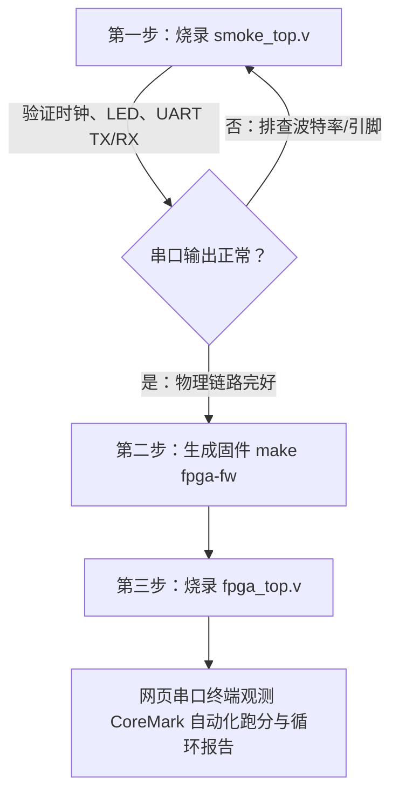

# 盘古 200K-MINI (PG2L200H-6FBB676) 板级综合与上板操作指南

本目录包含紫光同创（Pango Micro）Logos-2 系列 FPGA 的板级约束、顶层封装模块及固件镜像。

---

## 1. 目标平台与工具链

| 项目 | 参数 / 说明 |
|---|---|
| **FPGA 芯片** | 紫光同创 Logos-2 **PG2L200H-6FBB676**（Speed Grade: `-6`, Package: `FBB676`） |
| **开发板型** | 盘古 200K-MINI 核心板（带 27 MHz 晶振、UART、LED、按键、DDR3） |
| **EDA 综合工具** | **Pango Design Suite (PDS) 2022.2-SP6.4 win64**（建议对齐此版本，避免工程升级冲突） |
| **板载系统时钟** | **27 MHz** 有源晶振（引脚 **D18**，LVCMOS33，时钟周期 37.037 ns） |
| **物理串口参数** | **115200 8N1**（TX = **C24**, RX = **B24**，27 MHz 下 `CLKS_PER_BIT = 234`） |
| **板级顶层模块** | 1. 冒烟排查顶层：`smoke_top.v`<br>2. 完整 RISC-V SoC 顶层：`fpga_top.v` |
| **板级约束文件** | `pangu200k_mini.fdc` |

---

## 2. 两个顶层的验证策略



1. **第一阶段：硬件冒烟测试 (`smoke_top.v`)**
   - 不依赖 CPU 与总线，只验证 27 MHz 时钟输入、LED 心跳、UART 物理电平与波特率是否匹配。
   - 烧录后 LED0 以 1 Hz 闪烁，串口终端收到 `RV32 smoke test OK! > \r\n`，且终端键盘输入任意字符可原样回显并实时显示在 LED[7:1] 上。
2. **第二阶段：完整 SoC 系统测试 (`fpga_top.v`)**
   - 包含 RV32I 5 级流水线核、Wishbone 互连网络、64 KB 片上双端口 SRAM（推断为 DRM 块）、Wishbone UART 控制器与 CLINT 定时器。
   - 内置预加载的 `firmware_words.hex` 固件（CoreMark 基准测试，带 `#ifdef FPGA_BOARD_LOOP` 自动延时循环），上电或按键后持续输出跑分报告。

---

## 3. 分步操作清单 (Windows PDS 2022.2-SP6.4)

### 步骤 1：本地固件生成（Mac/Linux 端）

在代码根目录下运行：
```bash
make fpga-fw
```
该目标会自动：
1. 携带 `-DFPGA_BOARD_LOOP` 编译 CoreMark 嵌入式镜像生成 `build/coremark_board.elf`；
2. 转换为二进制 `build/coremark_board.bin`；
3. 执行 `sw/common/bin2words.py`，小端序每 4 字节打包为 1 个 32 位 Hex 字，并补齐为 16384 行（未用空间填充 NOP 00000013），生成 `platform/pango/firmware_words.hex`。

---

### 步骤 2：PDS 新建工程

1. 打开 PDS 2022.2-SP6.4，点击菜单栏 **File -> New Project**；
2. **Project Name**：建议填写 `rv32_soc_pangu200k`；
3. **Project Location**：选择工程存放路径；
4. **Device Selection**（严格选择）：
   - **Family**: `Logos2`
   - **Device**: `PG2L200H`
   - **Package**: `FBB676`
   - **Speed**: `-6`
5. 点击 **Finish** 完成工程创建。

---

### 步骤 3：添加 RTL 设计源文件

在左侧 **Design Summary / Hierarchy** 面板，右键点击 **Source Files -> Add Source**：

#### 方案 A：如果是跑 `smoke_top` 冒烟测试
添加以下 3 个文件：
- `platform/pango/smoke_top.v`（设为 Top 模块）
- `rtl/soc/uart_tx.v`
- `rtl/soc/uart_rx.v`

#### 方案 B：如果是跑 `fpga_top` 完整 RISC-V SoC
添加以下全部 RTL 源文件：
- **板级顶层**：`platform/pango/fpga_top.v`（右键 **Set as Top Module**）
- **SoC 外设与总线**：
  - `rtl/soc/soc_top.v`
  - `rtl/soc/wb_sram.v`
  - `rtl/soc/wb_core_bridge.v`
  - `rtl/soc/wb_interconnect.v`
  - `rtl/soc/wb_uart.v`
  - `rtl/soc/wb_clint.v`
  - `rtl/soc/uart_tx.v`
  - `rtl/soc/uart_rx.v`
- **硬件加速器**：
  - `rtl/acc/wb_mac_acc.v`
- **CPU 核心**：
  - `rtl/core/core.v`
  - `rtl/core/alu.v`
  - `rtl/core/alu_ops.vh`（或把 `rtl/core` 加入 Include Path）
  - `rtl/core/decoder.v`
  - `rtl/core/imm_gen.v`
  - `rtl/core/regfile.v`
  - `rtl/core/forwarding_unit.v`
  - `rtl/core/hazard_unit.v`
  - `rtl/core/bpu.v`
  - `rtl/core/muldiv.v`
- **固件初始化文件**：
  - 将 `platform/pango/firmware_words.hex` 复制到 PDS 工程根目录下（即 `.pds` 同级目录），或者在 `fpga_top.v` 中指定其相对/绝对路径。

---

### 步骤 4：导入引脚与时钟约束

1. 在左侧面板右键点击 **Constraint Files -> Import Constraint Files**；
2. 选择导入 `platform/pango/pangu200k_mini.fdc`；
3. 约束文件已预置好所有引脚映射与电气标准：
   - `sys_clk` -> `D18` (LVCMOS33)
   - `rst_n` -> `C22` (LVCMOS33)
   - `key[3:0]` -> `B20`, `A22`, `B22`, `C23`
   - `led[7:0]` -> `B17`, `C17`, `A18`, `A17`, `E18`, `C19`, `C18`, `A20`
   - `uart_txd` -> `C24`
   - `uart_rxd` -> `B24`

---

### 步骤 5：全流程综合、实现与生成比特流

双击左下角 **Flow** 窗口依次执行（或直接点击 **Generate Bitstream** 自动运行前置步骤）：
1. **Synthesize**（综合）：检查无语法错误，DRM 块存储器正确推断；
2. **Device Map**（技术映射）；
3. **Place & Route**（布局布线）：27 MHz 主频下时序宽松（周期 37 ns，WNS 余量充足）；
4. **Generate Bitstream**（生成位流文件）：在工程生成目录下获得 `.sbit` 文件。

---

### 步骤 6：远程平台烧录与串口观测

1. 在远程实验平台网页控制台，选择生成的 `.sbit` 文件上传并烧录进 FPGA；
2. 打开远程平台网页串口终端（Web Terminal），波特率设为 **115200**, 数据位 **8**, 停止位 **1**, 无校验 **None**；
3. **观测预期现象**：
   - **LED 指示灯**：
     - `LED[0]`（A20）：系统心跳灯，以约 0.8 Hz 周期性翻转闪烁，证明 27 MHz 主时钟正常；
     - `LED[1]`（C18）：指令退休指示灯（`wb_valid`），程序运行时常亮/微闪；
     - `LED[7:2]`：程序计数器 `PC[7:2]` 跳动指示，程序流动时呈现高速跳动状态。
   - **串口输出**：
     - 终端将清晰打印完整的 CoreMark 启动 Banner 与跑分报告：
       ```
       ==================================================
       [SoC] Booting RV32I Minimal System...
       [SoC] CPU Clock  : 27 MHz
       [SoC] UART Baud  : 115200 bps
       [SoC] SRAM Size  : 64 KB (Words: 16384)
       ==================================================
       2K performance run parameters for coremark.
       CoreMark Size    : 666
       Total ticks      : ...
       Total time (secs): ...
       Iterations/Sec   : ...
       Iterations       : 2
       Compiler version : -march=rv32i_zicsr -mabi=ilp32 -O2 -lgcc -DFPGA_BOARD_LOOP
       Correct operation validated.
       CoreMark/MHz     : ...
       ```
     - 打印完成后，CPU 延时约 3 秒，自动跳回 `_start` 再次执行并再次打印！用户随时切入终端都能看到完整跑分结果，彻底解决烧录瞬间错失首行输出的问题。
4. **手动重跑测试**：
   - 按下板上 `KEY0 / RST`（引脚 `C22`）或任意按键，双级同步消抖逻辑会检测到边沿脉冲并产生 256 拍软复位，随后 CPU 从头重新启动运行。

---

## 4. 常见问题排查 (FAQ)

1. **Q: 串口输出乱码或全是乱字符？**
   - **A**: 检查晶振频率设定。盘古 200K-MINI 核心板 `D18` 晶振为 **27 MHz**，115200 波特率对应的分频数为 `234`。若误用 50 MHz（分频数 434），会导致实际通信波特率出现近一倍的偏差而产生乱码。
2. **Q: PDS 报 `firmware_words.hex` 找不到或 DRM 初始化未生效？**
   - **A**: PDS 在执行综合推断 `$readmemh` 时，查找路径通常基于工程启动目录。请将 `firmware_words.hex` 复制一份放置在 `.pds` 工程文件同级目录下，或在 PDS 中将其作为数据源加入工程。
3. **Q: 上电后 CPU 没有自动跑起来，是否因为按键常闭？**
   - **A**: `fpga_top.v` 内部集成了 16 位内部上电复位计数器（POR），并在按键输入端采用了**边沿/跳变触发式 256 拍脉冲复位**，不会因为板载按键的高低电平反转导致 CPU 被电平长锁在复位态。
